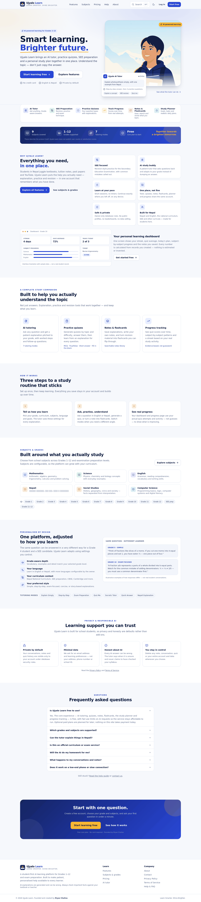

# Ujyalo Learn

**Learn smarter. Shine brighter.**

Ujyalo Learn is an AI-powered learning and tutoring platform for students in Nepal (Grades 1–12 and SEE candidates), built with React + Vite + TypeScript, Firebase, and a provider-independent AI backend that runs on Vercel serverless functions.

Founded and built by **Riyaz Chalise**.



---

## Contents

- [What is included](#what-is-included)
- [Architecture](#architecture)
- [Quick start (no credentials needed)](#quick-start-no-credentials-needed)
- [Environment variables](#environment-variables)
- [Firebase setup](#firebase-setup)
- [AI provider setup](#ai-provider-setup)
- [Deploying to Vercel](#deploying-to-vercel)
- [Data model and security rules](#data-model-and-security-rules)
- [Security model](#security-model)
- [Testing](#testing)
- [Known limitations](#known-limitations)
- [Project structure](#project-structure)
- [Accessibility, performance and PWA](#accessibility-performance-and-pwa)
- [Credits](#credits)

---

## What is included

### Public site

| Page | What it does |
| --- | --- |
| Home | Hero, tutor preview, feature cards, how it works, subjects and grades, personalisation explainer, privacy/responsible-AI section, FAQ, footer with founder credit |
| Features | Detailed explanation of every study tool |
| Subjects | All 9 subjects with grade and exam-category filters |
| Pricing | Real free tier, clearly labelled future plans, no fake checkout |
| Help | Student guide, troubleshooting, and a setup page for the site owner |
| About | Mission and founder credit (Riyaz Chalise) |
| Contact | Contact route with an honest “address not configured” state when no support email is set |
| Privacy / Terms | Data practices, parental consent, AI disclaimer, account deletion |
| 404 | Friendly not-found page |

### Student app (behind auth)

| Area | Details |
| --- | --- |
| Dashboard | Greeting, streak, quiz average, saved notes, open tasks, today's plan, continue-learning, subject progress, quiz history, goals, insights, recent notes — every number comes from stored records |
| AI Tutor | Streaming chat, Markdown + KaTeX, 7 tutoring modes, conversation CRUD (rename/delete), pagination-friendly history, stop generation, copy, regenerate, save to notes, offline and “AI not configured” states, English/Nepali |
| Quizzes | MCQ / true-false / short-answer / fill-in-the-blank, 3–15 questions, AI generation with structure validation, one-at-a-time or full view, answers hidden until submission, scoring, explanations, retry incorrect, regenerate, history |
| Study planner | Goals with target dates, tasks with subject and time estimate, complete/reschedule, “move overdue”, rule-based session suggestions, honest “no reminders configured” notice |
| Notes | Create/edit/delete, search, subject filter, AI vs student source badges, favourites, send a note to the flashcard generator |
| Flashcards | Generate from a topic or an existing note, deck list, full-screen reveal practice with shuffle and restart |
| Progress | Score trend, per-subject averages and best scores, 14-day activity, strengths and focus areas only after enough attempts, achievements from real counts |
| Study tools | Revision summary, formula helper, writing assistant (explains its changes), question explainer — all through the real AI backend |
| Settings | Learning preferences, profile, theme, service status, data export, typed-confirmation account deletion |

The app ships with **7 tutoring modes** (`explain-simply`, `step-by-step`, `exam-prep`, `quiz-me`, `socratic`, `quick-answer`, `nepali`) and **4 study tools**, each with genuinely different system prompts (see `api/_lib/prompts.ts`).

---

## Architecture

```
Browser (React 18 + Vite + Tailwind)
  ├── /src/pages          public + app pages (lazy-loaded routes)
  ├── /src/features       AuthProvider, DataProvider, RequireAuth
  ├── /src/services       auth (Firebase | local demo), data (Firestore | localStorage), ai client
  └── fetch → /api/*      same-origin, no API key ever reaches the browser
                │
                ▼
Vercel Node functions (/api)
  ├── tutor.ts            SSE streaming, mode prompts, rate limits, auth
  ├── tools.ts            revision summary, formulas, writing, question explainer
  ├── quiz.ts             JSON generation + schema validation + repair
  ├── flashcards.ts       JSON generation + validation
  ├── health.ts           { configured, provider, model, authRequired, limits }
  └── _lib/               config (SSRF allowlist), auth, rateLimit, provider, prompts, guard
                │
                ▼
Any OpenAI-compatible chat-completions provider
```

**Layers never leak:** the browser never sees `AI_API_KEY`, provider URLs, tokens, or raw provider errors.

All request bodies are validated with **Zod** (`shared/schemas.ts`) on both sides.

---

## Quick start (no credentials needed)

```bash
git clone <your-repo-url> ujyalo-learn
cd ujyalo-learn
npm install
cp .env.example .env.local     # optional for demo mode
npm run dev                    # http://localhost:5173
```

Without Firebase keys the app starts in **clearly labelled local demo mode**: accounts and study data live in `localStorage` on that device only. A banner appears on the dashboard, in Settings, and on the auth screens explaining this. Nothing pretends to be cloud-synced.

Without AI keys the tutor, quiz generator, flashcard generator and study tools show an explicit *“AI provider not configured”* state with setup help — they never fabricate an answer.

### Scripts

| Command | What it does |
| --- | --- |
| `npm run dev` | Vite dev server + local API server (port 8787) via `concurrently` |
| `npm run dev:web` / `npm run dev:api` | Run only one half |
| `npm run build` | Type-check, build, then generate SEO files (`postbuild`) |
| `npm run preview` | Preview the production build |
| `npm run typecheck` | `tsc -b --noEmit` |
| `npm test` | Vitest unit tests (75 tests) |
| `npm run smoke:api` | Spins up a mock provider + real API handlers and runs 20 integration checks |
| `npm run mock:provider` | Starts the mock OpenAI-compatible provider on port 9099 |
| `npm run check:secrets` | Scans the tree for credentials and unsafe `VITE_*` names |
| `npm run check:bundle` | Scans `dist/` for leaked secrets, checks the service worker guard |
| `npm run icons` | Regenerates PNG icons from the SVG sources |

---

## Environment variables

Copy `.env.example` → `.env.local` for local work, and add the same names in **Vercel → Project → Settings → Environment Variables** for production.

### Public (compiled into the browser — never put secrets here)

| Name | Required | Purpose |
| --- | --- | --- |
| `VITE_SITE_URL` | production | Canonical URL used for SEO tags, `sitemap.xml`, and the PWA manifest. Leave empty locally and the sitemap is skipped rather than inventing a domain. |
| `VITE_CONTACT_EMAIL` | optional | Shown on the Contact page. When empty the page says the address is not configured. |
| `VITE_FIREBASE_API_KEY` | for real accounts | Firebase web API key (public identifier, protected by rules) |
| `VITE_FIREBASE_AUTH_DOMAIN` | for real accounts | e.g. `your-project.firebaseapp.com` |
| `VITE_FIREBASE_PROJECT_ID` | for real accounts | Firebase project id |
| `VITE_FIREBASE_STORAGE_BUCKET` | optional | Only if you use Storage |
| `VITE_FIREBASE_MESSAGING_SENDER_ID` | optional | Only if you use FCM |
| `VITE_FIREBASE_APP_ID` | for real accounts | Firebase web app id |

### Server-only (never prefix with `VITE_`)

| Name | Default | Purpose |
| --- | --- | --- |
| `AI_API_KEY` | — | Provider key. Required for any AI feature. |
| `AI_API_BASE_URL` | `https://api.openai.com/v1` | OpenAI-compatible base URL. Must be `https` (or `http` on localhost with `AI_DEV_ALLOW_INSECURE=true`). |
| `AI_MODEL` | `gpt-4o-mini` | Model name passed through to the provider |
| `AI_PROVIDER_NAME` | `openai-compatible` | Label shown in `/api/health` |
| `AI_ALLOWED_HOSTS` | common providers | Comma-separated host allowlist — SSRF protection |
| `AI_REQUIRE_AUTH` | `false` | When `true`, every AI request needs a valid Firebase ID token |
| `AI_RATE_LIMIT_PER_MINUTE` | `12` | Best-effort per-client limit (per server instance) |
| `AI_MAX_REQUESTS_PER_DAY` | `120` | Best-effort daily cap |
| `AI_MAX_BODY_KB` | `32` | Hard body-size limit |
| `AI_REQUEST_TIMEOUT_MS` | `45000` | Upstream timeout |
| `AI_MAX_OUTPUT_TOKENS` | `1200` | Output token cap |
| `AI_TEMPERATURE` | `0.4` | Sampling temperature |
| `FIREBASE_PROJECT_ID` | — | Used with `FIREBASE_WEB_API_KEY` to verify ID tokens server-side |
| `FIREBASE_WEB_API_KEY` | — | Same public web key; used for token verification only |
| `ADMIN_UIDS` | — | Comma-separated Firebase UIDs with owner access (server-side only) |

`npm run check:secrets` fails the build if a real `.env` file is tracked, if a `VITE_*` name looks private, or if a credential-shaped string is committed.

---

## Firebase setup

1. **Create a project** at <https://console.firebase.google.com>. Google Analytics is not required.
2. **Add a web app** (Project settings → Your apps → Web). Copy the config values into `VITE_FIREBASE_*`.
3. **Enable Authentication** → Sign-in method:
   - Email/Password (required)
   - Google (optional; the app hides the button if it fails and shows a friendly message)
4. **Create Firestore** in production mode.
5. **Publish the rules and indexes** in this repo:
   ```bash
   npm i -g firebase-tools        # once
   firebase login
   firebase use --add             # select your project
   firebase deploy --only firestore:rules,firestore:indexes
   ```
   `firestore.rules` allows a user to read and write only their own documents under `users/{uid}/…`. Everything else is denied, including admin reads through the client SDK.
6. **Authorised domains**: Authentication → Settings → Authorized domains → add your Vercel domain (`your-project.vercel.app` and any custom domain). `localhost` is pre-authorised for development.
7. **Verify the setup**: run `npm run dev`, sign up, and confirm the header no longer says “Local demo mode”.

Optional server-side token verification (recommended for production): set `FIREBASE_PROJECT_ID` and `FIREBASE_WEB_API_KEY` on the server and `AI_REQUIRE_AUTH=true`. The API then rejects requests without a valid ID token and fails **closed** (503) if it cannot verify.

> Email verification: Firebase sends the verification email on sign-up. The app links to `/verify-email`, where students can resend it and refresh their status. Unverified accounts can still study; this is stated on the page.

---

## AI provider setup

Any provider that implements `POST {base}/chat/completions` with `stream: true` works — OpenAI, Groq, OpenRouter, Gemini’s OpenAI-compatible endpoint, Mistral, Together, DeepSeek, or a self-hosted gateway.

```env
AI_API_KEY=sk-...
AI_API_BASE_URL=https://api.openai.com/v1
AI_MODEL=gpt-4o-mini
AI_PROVIDER_NAME=openai
AI_ALLOWED_HOSTS=api.openai.com
```

Notes:

- The key must exist **only** in server environment variables (or server-side secrets management). Never `VITE_AI_*`.
- `AI_ALLOWED_HOSTS` prevents the API from being pointed at arbitrary or internal hosts. URLs with credentials, query strings or non-allowlisted hosts are rejected at startup.
- `GET /api/health` returns `{ configured, provider, model, authRequired, limits }` and nothing sensitive; the UI uses it to show the setup banner.
- Rate limits are **per server instance** and held in memory. Serverless instances scale horizontally, so treat them as a cost guard, not a hard quota. For strict global quotas, put a shared store (e.g. Upstash Redis) behind `api/_lib/rateLimit.ts` — the interface is intentionally small.
- If you want students to bring their own key later, add it as an opt-in “advanced” setting and store it only server-side; do not ship it in the client.

---

## Deploying to Vercel

> **Live:** **<https://ujyalo-learn.vercel.app>** — deployed 22 Oct 2026 with the Vercel CLI.
>
> Working now: every public page, PWA shell, onboarding, dashboard, notes, flashcards, planner, progress, settings and data export — with accounts in clearly labelled local demo mode.
> Waiting on keys you add in Vercel: real accounts/cloud sync (`VITE_FIREBASE_*`) and all AI features (`AI_API_KEY`). Until then `/api/health` reports `configured: false` and the AI screens show setup help instead of inventing answers.
>
> Full details, env vars and re-deploy steps: [`docs/DEPLOY-VERCEL.md`](docs/DEPLOY-VERCEL.md).

The repository is Vercel-ready (`vercel.json`, `/api` functions, Vite preset).

### Option A — Dashboard (recommended)

1. Push the repository to GitHub/GitLab/Bitbucket.
2. In Vercel: **Add New → Project → Import** the repository.
3. Framework preset: **Vite**. Build command `npm run build`, output `dist` (already set in `vercel.json`).
4. Add the environment variables from the tables above (Production **and** Preview).
5. Deploy.
6. Add the resulting domain to Firebase **Authorized domains**, then set `VITE_SITE_URL` to the final URL and redeploy so canonical links and `sitemap.xml` use it.

### Option B — CLI

```bash
npm i -g vercel
vercel link
vercel env add AI_API_KEY production
vercel --prod
```

### Custom domain

Vercel → Project → Domains → add your domain, then:

1. Set `VITE_SITE_URL=https://your-domain.com` and redeploy.
2. Add the domain to Firebase authorised domains.
3. Update the `Content-Security-Policy`/CSP note below if you add analytics.

`postbuild` writes `dist/robots.txt` always, and `dist/sitemap.xml` **only** when `VITE_SITE_URL` is a valid URL — no fabricated domains or non-existent pages.

### Post-deploy checklist

- [ ] `/api/health` returns `configured: true`
- [ ] Sign-up + sign-in work on the production domain
- [ ] Firestore rules deployed (`firebase deploy --only firestore:rules`)
- [ ] A tutor message streams and can be saved as a note
- [ ] Quiz generation, flashcards and study tools respond
- [ ] `/app` and `/login` carry `X-Robots-Tag: noindex`
- [ ] Lighthouse pass on mobile (see Testing)

---

## Data model and security rules

```
users/{uid}
  displayName, email, photoURL, preferences{grade, curriculum, language, subjects[], goals[],
  explanationStyle, dailyMinutes, country}, onboardingComplete, createdAt, updatedAt
  conversations/{conversationId}
    title, mode, subjectId, preview, messageCount, createdAt, updatedAt
    messages/{messageId}
      conversationId, role ('user'|'assistant'), content, mode, notice, createdAt
  notes/{noteId}        title, content, subjectId, topic, source('ai'|'student'), favorite, tags
  quizzes/{quizId}      title, subjectId, grade, topic, difficulty, questions[], source
  attempts/{attemptId}  quizId, quizTitle, subjectId, score, total, percent, answers[], durationSeconds
  decks/{deckId}        title, subjectId, topic, cards[{id,front,back}], source
  goals/{goalId}        title, subjectId, targetDate, completed
  tasks/{taskId}        title, subjectId, topic, date, minutes, goalId, completed, completedAt
  activity/{eventId}    type, label, subjectId, minutes
```

Rules (`firestore.rules`) enforce:

- owner-only reads/writes on every collection;
- `ownerId` must equal the authenticated uid at creation and cannot change;
- field type and length limits (titles ≤ 200 chars, content ≤ 20 000, ≤ 20 questions, ≤ 40 cards);
- scores must be integers within `0…total`;
- activity events are immutable;
- a catch-all `allow read, write: if false`.

Deletes are owner-only. Account deletion in Settings removes every collection for that uid before deleting the auth account; if the auth deletion fails the data removal is still reported honestly.

---

## Security model

| Risk | Mitigation |
| --- | --- |
| Key leakage | Key exists only in server env; `/api` is the only path to the provider; `check:bundle` and `check:secrets` scan for leaks |
| Prompt injection / abuse | Strict system prompt; request schema with size caps; per-client rate limits; daily caps; optional auth |
| SSRF | Provider URL must be `https`, host-allowlisted, credential- and query-free; path is fixed to `/chat/completions` |
| Cross-user data access | Firestore rules (owner checks) + UI guards; no admin reads through the client SDK |
| Oversized payloads | 32 KB body cap (413), ≤ 24 messages, ≤ 6 000 chars each, 3–15 quiz questions, 4–24 cards |
| Provider outage / timeouts | Structured errors (`provider_unavailable`, `timeout`, `rate_limited`, …), upstream timeouts, retry UI |
| Logging of content | The server logs only error codes/status — never prompts, keys or conversations |
| Malformed model output | Zod validation, JSON extraction from fenced blocks, answer repair (letter → option text, true/false normalisation), graceful failure |
| XSS | React escapes by default; Markdown is rendered with `react-markdown` + `rehype-katex` and no raw HTML plugin |
| Admin privilege | `ADMIN_UIDS` is server-only; there is no client-side admin route and no hardcoded password |
| Account deletion | Typed confirmation, data purge, auth deletion, honest error reporting |

**CSP:** no CSP header is set by default because the app inlines a tiny theme boot script and KaTeX fonts. If you add one, allow `'unsafe-inline'` for styles or move the boot script to a file, and allow `https://identitytoolkit.googleapis.com` + `https://securetoken.googleapis.com` for Firebase Auth.

---

## Testing

### Automated (all passing locally)

| Suite | Command | Result |
| --- | --- | --- |
| Unit / integration logic | `npm test` | **75 / 75** |
| API integration (real handlers + mock provider) | `npm run smoke:api` | **20 / 20** |
| Browser UI, demo mode, mobile, a11y basics | `npm run test:ui` (needs Playwright) | **40 / 40** |
| Browser UI with AI enabled (mock provider) | `npm run test:ai` (needs Playwright) | **17 / 17** |

What the unit tests cover: answer normalisation (case, punctuation, articles, numeric formats, accepted variants), scoring and attempt building, streak edge cases (today/yesterday/gaps/duplicates), planner recommendations and overdue rescheduling, progress aggregation and insight thresholds, SSE parsing, Zod schemas + JSON repair, provider-config SSRF validation, rate limiter windows, admin allowlist, and the prompt contracts (mode differences, honesty rules, required sections).

The API smoke test starts a **mock OpenAI-compatible provider** and the real handlers, then checks: health, key non-disclosure, streaming, JSON mode, validation errors, message-ending rules, 413 limits, quiz repair, flashcards, tools, provider failure mapping, 429 + `Retry-After`, fail-closed auth, and method guards.

The browser tests drive Chromium against the running dev server: public pages, 404, protected-route redirect, sign-up, the full 7-step onboarding, dashboard empty states, the “AI not configured” state (asserting no answer is fabricated), note CRUD + search + reload persistence, planner, progress honesty, tools, flashcards, settings, theme toggle, mobile overflow, and a skip link.

```bash
# Browser tests (Playwright is a dev dependency; browsers download once)
npx playwright install chromium
npm run dev            # in another terminal
npm run test:ui
```

### Manual QA still required before launch

These need real credentials or a real device, and are **awaiting configuration**:

1. Google sign-in with a real OAuth client.
2. Firebase email verification + password reset emails landing in an inbox.
3. Firestore rules against a live project (two accounts, cross-user access attempts).
4. A real provider key streaming in production (OpenAI/Groq/Gemini).
5. Vercel production deploy, custom domain, canonical URLs and sitemap.
6. PWA install prompt on Android/iOS and offline shell behaviour.
7. Screen-reader pass with NVDA/VoiceOver.

---

## Known limitations

- **Rate limiting is per instance**, in memory. Fine as a cost guard; not a global quota. Swap in a shared store for hard limits.
- **No payments.** The free tier is fully usable; future tiers are labelled “planned” and there is no checkout, no card fields, and no fake success screens.
- **No background notifications.** The planner says so explicitly: reminders/emails would require a notification service.
- **No admin dashboard.** Owner operations use the Firebase console; `ADMIN_UIDS` exists only server-side for future use.
- **No student-to-student sharing**, leaderboards, or social features by design.
- **Study time is approximate**: it comes from completed tasks and quiz attempts, never from page views or guessed reading time.
- **Progress insights require repeated attempts** (minimum 2 quizzes per subject) before calling anything a strength or a gap.
- **Offline mode is a shell only** — no AI requests are queued or answered offline, and the UI says so.
- **KaTeX + Markdown are the largest client chunks** (~440 kB and ~426 kB raw, lazily loaded on pages that need them).
- **Local demo mode is not secure** (plaintext localStorage, client-side hashing) and is only for evaluation; it is labelled as such everywhere.
- **No email support inbox**: the Contact page shows a form-style route but never claims to send mail. Set `VITE_CONTACT_EMAIL` to publish a real address.

---

## Project structure

```
api/                 Vercel serverless functions + shared server libs
  _lib/              config, http, auth, rateLimit, provider, prompts, guard
server/              dev-api.ts (same handlers, local development)
shared/              constants, Zod schemas, labels shared by client + server
src/
  components/        ui kit, layout, marketing, markdown, seo
  config/            curriculum, subjects, modes, tools, pricing copy
  features/auth/     AuthProvider, RequireAuth, AuthShell
  features/data/     DataProvider (conversations, notes, quizzes, …)
  hooks/             theme, online status, AI health
  lib/               quiz, streak, progress, planner, notes, format, errors
  pages/             public pages, auth pages, app pages
  services/          auth/, data/, ai/ (client)
  styles/            design tokens + component layer + KaTeX theme
  types/             domain types
public/              icons, manifest, service worker, offline page, robots
scripts/             SEO generator, icon/OG generators, secret + bundle checks,
                     mock provider, API smoke, browser smoke tests
tests/               Vitest suites
docs/                screenshots, testing notes
firestore.rules      production security rules
firestore.indexes.json
vercel.json
```

---

## Accessibility, performance and PWA

- Lazy-loaded routes, skeleton/loader states, and an error boundary around the app.
- Keyboard navigation, visible focus rings, skip links, 44px touch targets, `aria-live` for streaming answers and toasts.
- Respects `prefers-reduced-motion`; respects `prefers-color-scheme` until the student chooses a theme (persisted in `localStorage`).
- Mobile-first layout tested at 375 px with no horizontal overflow; sidebar collapses into a drawer.
- `manifest.webmanifest` + service worker: caches the app shell and static assets only, **never** `/api` or Firebase traffic; network-first for navigations; `offline.html` explains that AI needs a connection.
- Unique titles/descriptions, canonical URLs, OG/Twitter meta, `robots.txt`, `sitemap.xml` (when the domain is configured), `noindex` for private pages.

---

## Credits

**Ujyalo Learn** — concept, design and development by **Riyaz Chalise**.

Built with React, Vite, TypeScript, Tailwind CSS, Lucide icons, Firebase, Zod, React Markdown and KaTeX. AI responses are generated — they can be wrong, and the interface says so on every answer.
